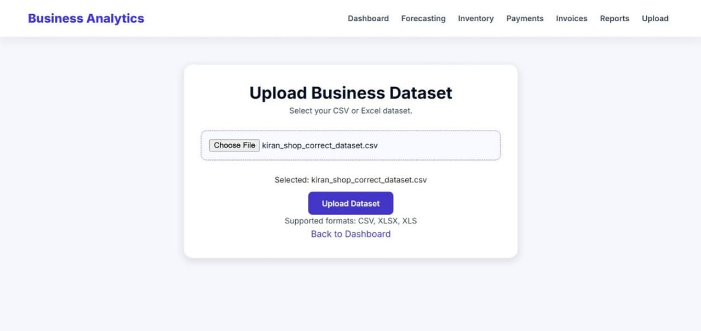

# Business-Sales-Dashboard
A Flask-based Business Sales Dashboard Analysis System for sales, profit, inventory, payments, and forecasting
📊 Business Sales Dashboard Analysis System

A full-stack Business Analytics Web Application developed using Python, Flask, Pandas, HTML, CSS, JavaScript, and Chart.js.
The system allows users to upload CSV and Excel datasets, analyze sales and profit, monitor inventory information, explore payment methods, review invoices, and visualize historical monthly sales trends through an interactive dashboard.
By combining data processing, business intelligence, inventory monitoring, and sales forecasting, this system helps businesses understand their sales performance, identify business trends, monitor stock levels, and make data-driven decisions.

📑 Table of Contents

1. "📌 Project Overview" 
2. "⚠️ Problem Statement" 
3. "🎯 System Objectives" 
4. "🏭 Industry Relevance & Use Cases" 
5. "✨ Key Features" 
6. "🧠 Machine Learning Model" 
7. "📦 Inventory Optimization Logic" 
8. "📐 System Architecture" 
9. "🔄 Data Flow & Workflow" 
10. "🛠️ Technologies Used" 
11. "📂 Project Folder Structure" 
12. "📊 Dataset Description" 
13. "⚙️ Installation & Setup" 
14. "🚀 How to Run the Project" 
15. "📈 Model Evaluation"
16. "🖥️ Dashboard Screenshots" 
17. "💡 Business Benefits" 
18. "🔮 Future Enhancements" 
19. "👩‍💻 Author" 
20. "📄 License" 

📌 Project Overview

The Business Sales Dashboard Analysis System is a web-based application developed using Python, Flask, and Pandas. It allows users to upload CSV and Excel files, analyze sales and profit, monitor inventory information, review payment methods, and visualize historical sales trends through interactive charts and reports. The system helps businesses understand their performance and make better data-driven decisions.

⚠️ Problem Statement

- Stockouts: Insufficient inventory can lead to missed sales opportunities and customer dissatisfaction.
- Overstocking: Excess inventory increases storage costs and ties up business capital.
- Manual Bottlenecks: Manual sales calculations and spreadsheet-based reporting consume time and effort.
- Data Analysis Challenges: Analyzing large amounts of sales data manually makes it difficult to identify trends, profitable categories, and regional performance.

🎯 System Objectives

1. Data Processing: Process business data from CSV and Excel files using Pandas.
2. Sales Analysis: Calculate total sales, profit, and order metrics.
3. Performance Analysis: Compare sales across different regions and product categories.
4. Inventory Monitoring: Identify low-stock products using available inventory data.
5. Payment Analysis: Analyze sales by different payment methods.
6. Historical Trend Analysis: Visualize monthly sales trends using interactive charts.
7. Business Reporting: Generate useful summaries to support business decisions.

🏢 Industry Relevance & Use Cases

- Retail Stores: Analyze sales performance and product categories.
- E-Commerce Businesses: Understand sales trends and customer purchasing patterns when customer data is available.
- Supermarkets: Review sales records and monitor inventory information.
- Sales Teams: Compare regional sales and profitability.
- Business Managers: Use interactive dashboards and reports to make data-driven decisions.

✨ Key Features

1. 📊 Interactive Business Dashboard

- Total sales and profit KPIs.
- Business performance monitoring.
- Interactive charts and graphs.
- Sales trend visualization.

2. 📁 Dataset Upload

- CSV dataset upload.
- Excel dataset upload.
- Data processing using Pandas.
- Business data analysis.

3. 📦 Product Management

- Manage product information.
- View product details.
- Monitor product availability.

4. 💰 Sales Analysis

- Total sales analysis.
- Profit calculation.
- Monthly sales trends.
- Product performance analysis.

5. 📋 Inventory Management

- Monitor available stock.
- Track product quantities.
- Identify low-stock products.
- Inventory status monitoring.

6. 💳 Payment Analysis

- Analyze different payment methods.
- Understand payment distribution.
- Visualize payment trends.

7. 🧾 Invoice Management

- Review customer invoices.
- Track transaction details.
- Monitor sales records.

8. 🤖 ML Sales Forecasting

- Predict next-month sales.
- Compare actual and predicted sales.
- Visualize forecasting results.
- Evaluate model performance using MAE and RMSE.

9. 🔍 Advanced Dashboard Filters

- Date-wise filtering.
- Category-wise filtering.
- Region-wise filtering.
- Dynamic KPI and chart updates.

10. 💡 Smart Business Insights

- Identify top-selling products.
- Find highest-profit categories.
- Identify the best sales month.
- Generate business recommendations.
- Support data-driven decisions.

🧠 Machine Learning Model

The system uses Machine Learning techniques to analyze historical sales information and predict future sales.

Forecasting Process

1. Collect historical sales data.
2. Preprocess the dataset using Pandas.
3. Prepare input features and target values.
4. Train a Linear Regression model.
5. Predict next-month sales.
6. Compare actual and predicted sales.
7. Evaluate model performance.

Evaluation Metrics

- MAE: Mean Absolute Error.
- RMSE: Root Mean Squared Error.

These metrics help measure the difference between actual sales and predicted sales.

📦 Inventory Optimization Logic

The inventory module helps businesses monitor product stock levels.

Inventory Process

1. Read product inventory information.
2. Check available stock quantities.
3. Identify products below the defined stock threshold.
4. Generate low-stock alerts.
5. Help businesses plan inventory replenishment.

📐 System Architecture

             Dataset Upload
                   |
                   ▼
             Data Processing
                (Pandas)
                   |
                   ▼
             Database (SQLite)
                   |
                   ▼
              Flask Backend
                   |
          ┌────────┴─────────┐
          ▼                  ▼
     Data Analysis      ML Forecasting
          |                  |
          └────────┬─────────┘
                   ▼
            Business Insights
                   |
                   ▼
          Interactive Dashboard
                   |
                   ▼
          HTML, CSS, JavaScript
                   |
                   ▼
              Chart.js

🔄 Data Flow & Workflow

⚙️ Work Process

1. Data Upload: Upload business sales data in CSV or Excel format.
2. Data Processing: Process and organize the dataset using Pandas.
3. Data Analysis: Calculate total sales, profit, and order metrics.
4. Performance Analysis: Analyze sales by region, category, and payment method.
5. Data Visualization: Display business insights using interactive charts.
6. Inventory Monitoring: Identify low-stock products when inventory data is available.
7. Report Generation: Present business performance summaries and historical sales trends.

🛠️ Technologies Used

Technology| Purpose
Python| Backend Programming
Flask| Web Framework
Pandas| Data Processing
NumPy| Numerical Computation
Scikit-learn| Machine Learning
SQLite| Database Management
HTML5| Webpage Structure
CSS3| User Interface Design
JavaScript| Frontend Interactivity
Chart.js| Data Visualization

📂 Project Folder Structure

Business-Sales-Dashboard/
│
├── app.py
├── requirements.txt
├── README.md
├── database.db
│
├── templates/
│   └── index.html
│
├── static/
│   ├── css/
│   ├── js/
│   └── images/
│
├── uploads/
│
├── models/
│
└── screenshots/
    ├── dashboard.png
    ├── products.png
    ├── sales.png
    ├── inventory.png
    ├── forecast.png
    └── insights.png

Note: Update this structure to match your actual project folders and files.

📊 Dataset Description

The system supports CSV and Excel datasets containing business sales information.

Example dataset fields:

Column| Description
Order ID| Unique transaction ID
Order Date| Date of purchase
Product| Product name
Category| Product category
Region| Sales region
Quantity| Number of products sold
Sales| Total sales amount
Profit| Profit earned
Payment Method| Transaction payment type
Stock| Available product quantity

The actual dataset columns should match the fields expected by the application.

⚙️ Installation & Setup

Step 1: Clone the Repository

git clone YOUR_GITHUB_REPOSITORY_URL

Step 2: Navigate to the Project Folder

cd Business-Sales-Dashboard

Step 3: Create a Virtual Environment (Optional)

python -m venv venv

Step 4: Activate Virtual Environment

Windows:

venv\Scripts\activate

Step 5: Install Required Dependencies

pip install -r requirements.txt

🚀 How to Run the Project

Step 1: Upload Business Sales Dataset

- Open the application.
- Upload a CSV or Excel dataset.
- Ensure the dataset contains the required columns.

Step 2: Run the Application

python app.py

Step 3: Launch the Dashboard

Open your browser and visit:

http://127.0.0.1:5000

Step 4: Explore Business Analytics

- View sales and profit KPIs.
- Analyze product performance.
- Monitor inventory and low-stock alerts.
- Explore payment and invoice information.
- Apply dashboard filters.
- View sales forecasting and smart insights.

📈 Model Evaluation

The sales forecasting model can be evaluated using:

1. Mean Absolute Error (MAE)

Measures the average absolute difference between actual and predicted sales.

2. Root Mean Squared Error (RMSE)

Measures prediction errors while giving greater weight to larger errors.

Lower MAE and RMSE values generally indicate better prediction performance.

## 📸 Project Screenshots

### 1. Dashboard

### 2. Upload Dataset

### 3. Inventory Management

### 4. Payment Analysis

### 5. Invoice Management

### 6. Sales Forecasting

### 7. Business Reports

💡 Business Benefits

- Helps businesses understand sales performance.
- Reduces manual data analysis efforts.
- Improves inventory monitoring.
- Identifies low-stock products.
- Helps understand profitable products and categories.
- Supports future sales planning.
- Provides meaningful business insights.
- Enables data-driven decision-making.

🔮 Future Enhancements

- Automated inventory replenishment.
- Advanced Machine Learning forecasting models.
- Real-time sales monitoring.
- Export reports as PDF and Excel.
- Role-based Admin and User access.
- Cloud deployment.
- Advanced customer purchase analysis.

